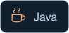
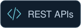
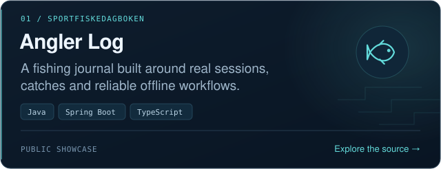
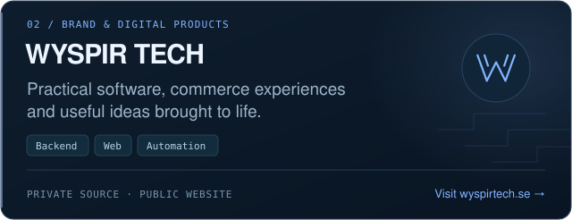
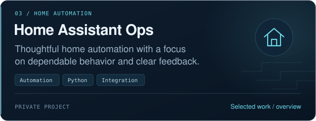
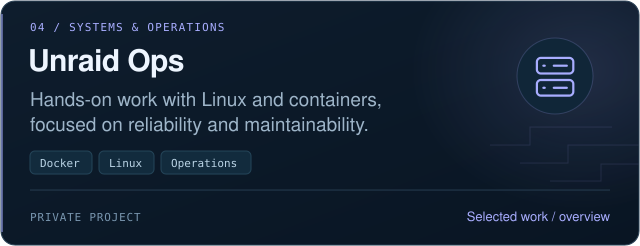
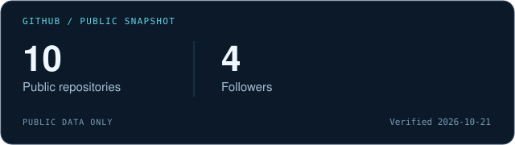

<!-- All artwork is local, static SVG. No tracking pixels or external statistics widgets. -->

  

## Practical software. Thoughtful engineering.

I'm **Stefan Öberg**, a Java developer student focused on backend development, automation and AI. I enjoy turning practical problems into useful applications, from fishing journals to reliable everyday systems.

**WYSPIR TECH** is where I bring that work together. My approach is hands-on: understand the problem, build a focused solution, test the behavior and keep improving. I use AI-assisted development alongside deliberate review and verification.

[Projects](#featured-projects) · [Tech stack](#tech-stack) · [Current focus](#current-focus) · [Connect](#connect)

## Tech stack

  
  
  
  
  
  
  
  
  
  
  
  
  

**Backend:** Java · Spring Boot · PostgreSQL · REST APIs 
**Applications:** JavaScript · TypeScript · React Native 
**Systems & tooling:** Docker · Linux · Git · GitHub · Python · AI / Automation

## Featured projects

Selected work across applications, automation and systems. Explore the public showcase or website where linked; private source stays private.

## GitHub activity

*Verified on 21 October 2026: **10 public repositories · 4 followers**. This is a dated snapshot, not a live counter.* 
[Current repositories](https://github.com/oberg89?tab=repositories) · [Contribution activity](https://github.com/oberg89?tab=overview)

## Current focus

- **Java & backend:** clearer domain models, well-defined REST APIs and focused tests.
- **Applications:** dependable data flows and thoughtful mobile and offline experiences.
- **Automation & AI:** useful integrations with understandable behavior and human oversight.

## Connect

[LinkedIn](https://www.linkedin.com/in/stefan-%C3%B6berg-07b65686) · [WYSPIR TECH](https://wyspirtech.se) · [GitHub](https://github.com/oberg89)

---

Stefan Öberg · WYSPIR TECH Building software that solves real problems.

