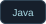
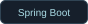
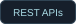
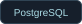
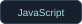
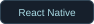

<h1 align="center">Stefan Öberg</h1>

<strong>Java Developer | Backend Development | Spring Boot</strong>

<em>Building practical software with a focus on clean architecture and reliable systems.</em>

---

## About Me

I'm studying Java development and building real applications, with a focus on backend development, APIs, databases, and system integration.

## Tech Stack

<table>
<tr><th align="left">Area</th><th align="left">Technologies</th></tr>
<tr><td>Backend</td><td>  </td></tr>
<tr><td>Database</td><td></td></tr>
<tr><td>Frontend / Mobile</td><td>  </td></tr>
<tr><td>Tools &amp; Infrastructure</td><td>   </td></tr>
</table>

## Featured Project

### Angler Log

*Track. Learn. Catch more.*

A private fishing journal for recording sessions, analysing catches, and improving your fishing.

  

**[Explore the public showcase →](https://github.com/oberg89/SportfiskeDagboken-showcase)**

---

<a href="https://www.linkedin.com/in/stefan-%C3%B6berg-07b65686">Connect on LinkedIn ↗</a>

