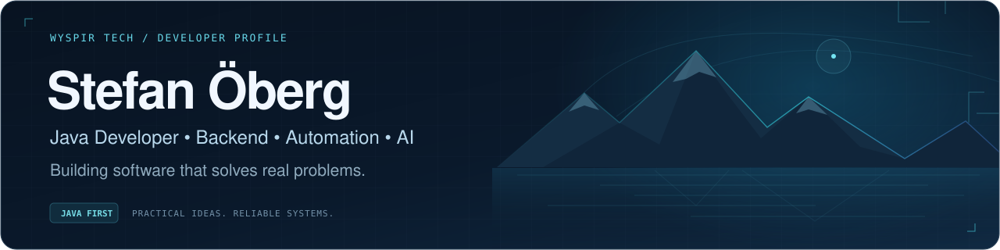
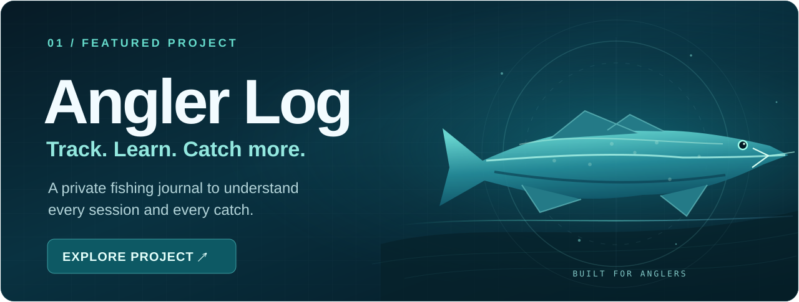

<!-- Minimal public portfolio: only Angler Log is featured. All artwork is local, static SVG. -->

  

  <strong>Java developer · Backend engineering · Sweden</strong>

  

  <a href="https://github.com/oberg89/SportfiskeDagboken-showcase"><strong>Explore Angler Log ↗</strong></a>
  &nbsp; · &nbsp;
  <a href="https://www.linkedin.com/in/stefan-%C3%B6berg-07b65686">LinkedIn ↗</a>

Java &nbsp;·&nbsp; Spring Boot &nbsp;·&nbsp; PostgreSQL &nbsp;·&nbsp; REST APIs

